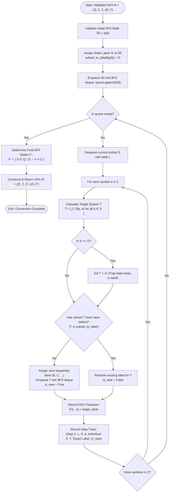
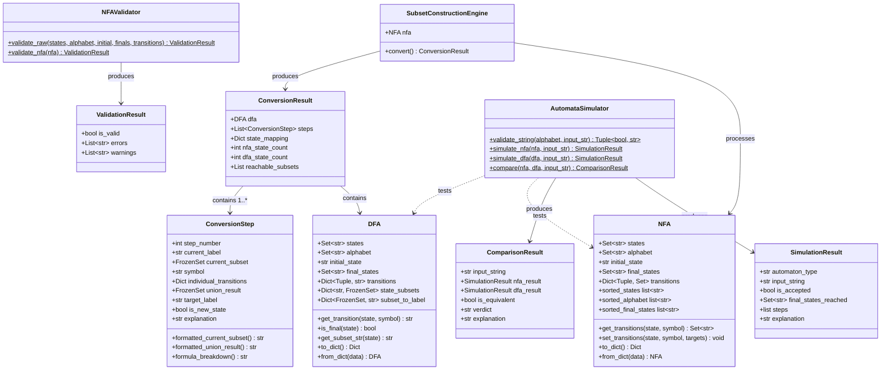
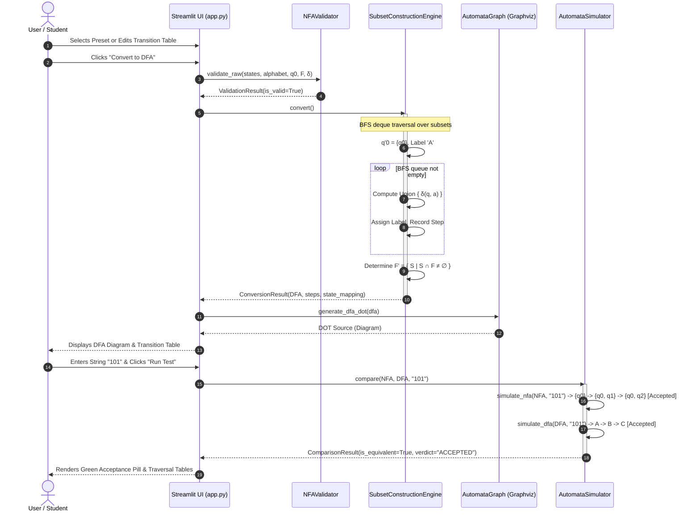

# NFA to DFA Conversion Simulator: Comprehensive System Documentation & Academic Report

**Course Reference**: Automata Theory & Formal Languages / Theory of Computation (B.Tech CSE)  
**Author**: Kabir Nagdev  
**Repository**: [https://github.com/kabirnagdev/NFA-to-DFA-converter](https://github.com/kabirnagdev/NFA-to-DFA-converter)  
**Implementation Stack**: Python 3.13, Streamlit, Graphviz, Matplotlib, Pytest  

---

## 1. Existing-Tool Analysis & Comparative Evaluation

### 1.1 Overview of Existing Solutions
Automata Theory education has historically relied on desktop utilities and rudimentary web widgets. To identify design requirements and architectural gaps, four representative tools were analyzed:

1. **JFLAP (Java Formal Languages and Automata Package)**
   - *Architecture*: Java Swing desktop application (Duke University).
   - *Strengths*: Highly comprehensive theoretical scope (regular, context-free, Turing machines).
   - *Weaknesses*: Heavy legacy Java JRE dependency; complex multi-window modal dialogs; high friction for modern web access; prone to GUI scaling issues on modern high-DPI displays.
2. **Cyberzhg Automata Simulator (cyberzhg.github.io)**
   - *Architecture*: Client-side JavaScript / HTML Canvas.
   - *Strengths*: Instant browser access without installation; graph rendering via Vis.js.
   - *Weaknesses*: Black-box conversion; lacks granular step-by-step mathematical transition derivations; no explicit trap/dead state self-loop reporting; no side-by-side synchronized execution traces between NFA and DFA.
3. **Automata-lib / FSMView (Python CLI & Libraries)**
   - *Architecture*: Headless Python library (`automata-lib`) coupled with static Graphviz output.
   - *Strengths*: Algorithmic purity; scriptable.
   - *Weaknesses*: Lacks any graphical frontend for undergraduate classroom interaction; requires Python programming knowledge to specify state transitions.
4. **TOC Tools / Stanford Automata Applets**
   - *Architecture*: Early JavaScript / Canvas applets.
   - *Strengths*: Interactive node dragging.
   - *Weaknesses*: Unmaintained; strict limitations on alphabet size and multi-character state identifiers; no integrated test suites or validation layers.

---

### 1.2 Feature Comparison Matrix

| Evaluation Dimension | JFLAP 7.1 | Cyberzhg Web Simulator | automata-lib (Python) | **Our Simulator (NFA-to-DFA)** |
| :--- | :--- | :--- | :--- | :--- |
| **Delivery Mechanism** | Java Desktop (.jar) | Static Web (JS) | Python Library | **Modern Reactive Web (Streamlit)** |
| **Installation Friction** | High (Java JRE required) | None | Medium (`pip install`) | **Zero (One-click Web Deployment)** |
| **State Input Interface** | Visual drag-and-drop nodes | Text / Canvas | Python dictionary code | **Interactive Editable Matrix (`st.data_editor`)** |
| **Algorithmic Transparency** | Step-by-step available | Black-box single result | Headless / Programmatic | **Granular BFS Trace with Set Union Formulas** |
| **Trap State Handling** | Implicit | Frequently omitted | Standard | **Explicit $\emptyset$ Trap State with Self-loops** |
| **String Simulation** | Graphical stepwise | Single string result | Programmatic boolean | **Synchronous NFA vs. DFA Side-by-Side Trace** |
| **Automated Testing Suite** | None (Manual GUI tests) | None | Unit tests available | **18 `pytest` Tests (100% Pass Rate)** |
| **Visual Styling** | Legacy Java Look & Feel | Utilitarian Canvas | None / External Graphviz | **Clean Academic Palette (Navy, Slate, Crisp Tables)** |

---

### 1.3 Key Innovations & Academic Contribution
- **Pedagogical Derivation Transparency**: Rather than treating conversion as an atomic transform, the system breaks down every BFS discovery step: $\delta'(S, a) = \bigcup_{q \in S} \delta(q, a)$, highlighting individual constituent transitions and state discovery status.
- **Synchronized Equivalence Proof**: Evaluates strings concurrently on both automata, displaying the deterministic path $S_0 \to S_1 \to \dots \to S_k$ alongside the non-deterministic active state sets $\{q\} \to \{q_a, q_b\}$, visually reinforcing that $L(M) = L(M')$.
- **Strict Formal Validation**: Detects undeclared states, invalid symbols, and malformed inputs upfront while gracefully treating empty transitions as $\emptyset$.

---

## 2. System Architecture, Flowchart & UML Specifications

### 2.1 System Architecture Diagram

```
+---------------------------------------------------------------------------------------+
|                                    PRESENTATION LAYER                                 |
|  +---------------------------------------------------------------------------------+  |
|  |                     Streamlit Multi-Page Reactive Web Interface                  |  |
|  |   [Overview]   [NFA Setup]   [NFA Graph]   [DFA Result]   [Trace]   [Simulator]     |  |
|  +---------------------------------------------------------------------------------+  |
+-------------------------------------------|-------------------------------------------+
                                            | Session State & Event Dispatch
+-------------------------------------------v-------------------------------------------+
|                                APPLICATION & CONTROLLER LAYER                         |
|  +----------------------------+  +-------------------------------+  +---------------+ |
|  |   Navigation Controller    |  |       Input Form Handler      |  |  Session Bus  | |
|  |   (Deferred nav_target)    |  |     (st.data_editor sync)     |  | (st.session)  | |
|  +----------------------------+  +-------------------------------+  +---------------+ |
+-------------------------------------------|-------------------------------------------+
                                            |
         +----------------------------------+----------------------------------+
         |                                  |                                  |
         v                                  v                                  v
+-----------------------+      +---------------------------+      +---------------------+
|      CORE DOMAIN      |      |     ALGORITHMIC ENGINE    |      |  VISUALIZATION &    |
|  +-----------------+  |      |  +---------------------+  |      |     SIMULATION      |
|  |    NFA Model    |  |      |  | Subset Construction |  |      |  +---------------+  |
|  | (Q,Σ,δ,q0,F)    |  |      |  | (BFS deque, subset) |  |      |  | Graphviz DOT  |  |
|  +-----------------+  |      |  +---------------------+  |      |  | Generator     |  |
|  +-----------------+  |      |  +---------------------+  |      |  +---------------+  |
|  |    DFA Model    |  |      |  | Validation Pipeline |  |      |  +---------------+  |
|  | (Q',Σ,δ',q'0,F')|  |      |  | (NFAValidator)      |  |      |  | Automata      |  |
|  +-----------------+  |      |  +---------------------+  |      |  | Simulator     |  |
+-----------------------+      +---------------------------+      |  +---------------+  |
                                                                  +---------------------+
```

---

### 2.2 Algorithm Flowchart (Subset Construction Algorithm)



---

### 2.3 Class Diagram (UML)



---

### 2.4 Sequence Diagram (End-to-End User Conversion & Simulation Flow)



---

## 3. User Interface Mock-Ups & Wireframe Specifications

### 3.1 Overview Page (`1. Overview`)
```
========================================================================================
  [Sidebar Menu]     NFA TO DFA CONVERTER
  1. Overview (*)    Convert non-deterministic finite automata to deterministic state
  2. NFA Setup       machines with step-by-step subset construction.
  3. NFA Graph       -------------------------------------------------------------------
  4. DFA Result      [ Load Demo: Ends with '01' ]   [ Configure Custom NFA -> ]
  5. Trace           -------------------------------------------------------------------
  6. String Tester   +-------------------+  +-------------------+  +-------------------+
                     | 1. Build NFA      |  | 2. Subset Constr. |  | 3. Test Strings   |
  STATUS:            | Specify states,   |  | BFS explores      |  | Test strings on   |
  NFA: 3 states      | alphabet, and δ   |  | reachable subsets |  | both automata to  |
  DFA: 3 states      | or load a preset. |  | to build DFA.     |  | check equivalence.|
                     +-------------------+  +-------------------+  +-------------------+
========================================================================================
```

### 3.2 NFA Configuration (`2. NFA Setup`)
```
========================================================================================
  NFA Configuration
  Select Preset: [ Demo: Strings ending in '01' [v] ]  [ Load Preset ]  [ Reset ]
  --------------------------------------------------------------------------------------
  Automaton Setup:
  States (Q): [ q0, q1, q2               ]    Alphabet (Σ): [ 0, 1                     ]
  Start State: [ q0                      ]    Accept States (F): [ q2                  ]

  Transition Table (δ):
  +--------------------+-------------------+-------------------------------------------+
  | Current State      | Symbol            | Next States (comma-separated or blank)    |
  +--------------------+-------------------+-------------------------------------------+
  | q0                 | 0                 | q0, q1                                    |
  | q0                 | 1                 | q0                                        |
  | q1                 | 0                 |                                           |
  | q1                 | 1                 | q2                                        |
  | q2                 | 0                 |                                           |
  | q2                 | 1                 |                                           |
  +--------------------+-------------------+-------------------------------------------+
  [ Validate ]   [ Convert to DFA (Primary) ]
  --------------------------------------------------------------------------------------
  [✓] NFA is valid and ready for conversion.
  States: 3  |  Alphabet: 2  |  Start: q0  |  Accepting: 1
  [ View NFA Graph -> ]   [ View DFA Result -> ]
========================================================================================
```

### 3.3 Converted DFA Output (`4. DFA Result`)
```
========================================================================================
  Converted DFA (Deterministic Finite Automaton)
  [ View Step-by-Step Trace -> ]   [ Test Input Strings -> ]
  --------------------------------------------------------------------------------------
  [ 3 NFA States ]   [ 3 Reachable DFA States ]   [ 8 Powerset Max ]   [ 1 DFA Final ]
  --------------------------------------------------------------------------------------
  DFA State Transition Diagram             |  DFA State Mapping
  (start)                                  |  +-------+------------+---------------+
     |                                     |  | State | NFA Subset | Type          |
     v                                     |  +-------+------------+---------------+
   [ A ] --- 0 ---> [ B ]                  |  | A     | {q0}       | Start         |
     ^                |                    |  | B     | {q0, q1}   | Normal        |
     |-- 1 ---+       |-- 1 --> (( C ))    |  | C     | {q0, q2}   | Accepting (*) |
              |       |            |       |  +-------+------------+---------------+
              +-------+            |       |  Complexity Chart:
                      ^--- 0 ------+       |  [ Bar: NFA=3 | DFA=3 | Max=8 ]
  --------------------------------------------------------------------------------------
  DFA Complete Transition Matrix:
  +-------+------------+---------------+----------------+----------------+
  | State | NFA Subset | Type          | On '0'         | On '1'         |
  +-------+------------+---------------+----------------+----------------+
  | A     | {q0}       | Start (->)    | B ({q0, q1})   | A ({q0})       |
  | B     | {q0, q1}   | Normal        | B ({q0, q1})   | C ({q0, q2})   |
  | C     | {q0, q2}   | Accept (*)    | B ({q0, q1})   | A ({q0})       |
  +-------+------------+---------------+----------------+----------------+
========================================================================================
```

### 3.4 String Tester (`6. String Tester`)
```
========================================================================================
  String Tester & Equivalence Verifier
  Valid alphabet Σ: {0, 1}. Leave blank for the empty string (ε).
  Quick Test Presets: [ 01 ] [ 101 ] [ 001 ] [ 10 ] [ 111 ] [ 010 ] [ ε (Empty) ]
  --------------------------------------------------------------------------------------
  Input String: [ 101                       ]   [ Run Test ]

  +------------------------------------------------------------------------------------+
  | [✓] RESULT: ACCEPTED  •  Both NFA and DFA accepted string '101'.                   |
  +------------------------------------------------------------------------------------+
  Both automata agree: '101' is ACCEPTED. NFA active states {q0, q2} match DFA state C.

  Deterministic DFA Path:                  | Non-deterministic NFA Active States:
  +------+--------+---------+------+-------+ +------+--------+---------------+----------+
  | Step | Symbol | Current | Next | Acc.? | | Step | Symbol | Active States | Next Act.|
  +------+--------+---------+------+-------+ +------+--------+---------------+----------+
  | 0    | (start)| A       | A    | No    | | 0    | (start)| {q0}          | {q0}     |
  | 1    | 1      | A       | A    | No    | | 1    | 1      | {q0}          | {q0}     |
  | 2    | 0      | A       | B    | No    | | 2    | 0      | {q0}          | {q0, q1} |
  | 3    | 1      | B       | C    | Yes(*)| | 3    | 1      | {q0, q1}      | {q0, q2}*|
  +------+--------+---------+------+-------+ +------+--------+---------------+----------+
========================================================================================
```

---

## 4. Formal Algorithm Specification, Pseudocode & Complexity

### 4.1 Theoretical Foundation (Rabin-Scott Powerset Construction)
Given an NFA $M = (Q, \Sigma, \delta, q_0, F)$ without $\epsilon$-transitions, the equivalent DFA $M' = (Q', \Sigma, \delta', q'_0, F')$ is formally defined by:
1. $q'_0 = \{q_0\}$
2. $\delta'(S, a) = \bigcup_{q \in S} \delta(q, a)$ for every subset $S \subseteq Q$ and symbol $a \in \Sigma$.
3. $F' = \{S \in Q' \mid S \cap F \neq \emptyset\}$.
4. $Q' \subseteq 2^Q$ restricted strictly to subsets reachable from $q'_0$.

---

### 4.2 Algorithm 1: Subset Construction Engine

```text
Algorithm: SUBSET_CONSTRUCTION
Input    : NFA M = (Q, Σ, δ, q0, F)
Output   : ConversionResult containing DFA M' = (Q', Σ, δ', q'0, F'), Steps, and Mapping

1:  Let queue be an empty FIFO queue (collections.deque)
2:  Let subset_to_label be an empty hash table (frozenset -> str)
3:  Let label_to_subset be an empty hash table (str -> frozenset)
4:  Let dfa_transitions be an empty hash table ((str, str) -> str)
5:  Let steps be an empty list of ConversionStep records
6:  Let label_counter ← 0
7:  
8:  // Step 1: Initialize Start State
9:  S0 ← frozenset({q0})
10: initial_label ← GENERATE_LABEL(label_counter)
11: label_counter ← label_counter + 1
12: 
13: subset_to_label[S0] ← initial_label
14: label_to_subset[initial_label] ← S0
15: queue.ENQUEUE(S0)
16: 
17: // Step 2: BFS Exploration of Reachable Subsets
18: while queue is not empty do
19:     current_subset ← queue.DEQUEUE()
20:     current_label ← subset_to_label[current_subset]
21:     
22:     for each symbol a ∈ SORTED(Σ) do
23:         target_subset ← ∅
24:         individual_trans ← empty dictionary
25:         
26:         if current_subset == ∅ then
27:             // Trap/Dead state loops to itself for all symbols
28:             target_subset ← frozenset()
29:         else
30:             for each state q ∈ SORTED(current_subset) do
31:                 targets ← δ(q, a)
32:                 individual_trans[q] ← targets
33:                 target_subset ← target_subset ∪ targets
34:             end for
35:             target_subset ← frozenset(target_subset)
36:         end if
37:         
38:         is_new ← FALSE
39:         if target_subset ∉ subset_to_label then
40:             target_label ← GENERATE_LABEL(label_counter)
41:             label_counter ← label_counter + 1
42:             subset_to_label[target_subset] ← target_label
43:             label_to_subset[target_label] ← target_subset
44:             queue.ENQUEUE(target_subset)
45:             is_new ← TRUE
46:         else
47:             target_label ← subset_to_label[target_subset]
48:         end if
49:         
50:         dfa_transitions[(current_label, a)] ← target_label
51:         
52:         // Step 3: Record granular derivation step
53:         step_record ← ConversionStep(
54:             step_number=LENGTH(steps) + 1,
55:             current_label=current_label,
56:             current_subset=current_subset,
57:             symbol=a,
58:             individual_transitions=individual_trans,
59:             union_result=target_subset,
60:             target_label=target_label,
61:             is_new_state=is_new
62:         )
63:         steps.APPEND(step_record)
64:     end for
65: end while
66: 
67: // Step 4: Classify Final / Accepting States
68: dfa_states ← KEYS(label_to_subset)
69: dfa_final_states ← empty set
70: for each label ∈ dfa_states do
71:     subset ← label_to_subset[label]
72:     if subset ∩ F ≠ ∅ then
73:         dfa_final_states.ADD(label)
74:     end if
75: end for
76: 
77: Construct DFA M' = (dfa_states, Σ, dfa_transitions, initial_label, dfa_final_states)
78: return ConversionResult(dfa=M', steps=steps, state_mapping=label_to_subset)
```

---

### 4.3 Algorithm 2: Synchronous Automata Execution & Equivalence Verifier

```text
Algorithm: DUAL_SIMULATE_AND_COMPARE
Input    : NFA M = (Q, Σ, δ, q0, F), DFA M' = (Q', Σ, δ', q'0, F'), String w = a1 a2 ... ak
Output   : ComparisonResult(is_equivalent, verdict, nfa_steps, dfa_steps)

1:  // Validate input string
2:  if ∃ c ∈ w such that c ∉ Σ then
3:      return ERROR("Symbol not in alphabet")
4:  end if
5:  
6:  // --- DFA Execution (Deterministic O(|w|)) ---
7:  curr_dfa_state ← q'0
8:  dfa_trace ← [ (Step=0, Symbol=NULL, State=curr_dfa_state) ]
9:  for i ← 1 to LENGTH(w) do
10:     curr_dfa_state ← δ'(curr_dfa_state, w[i])
11:     dfa_trace.APPEND( (Step=i, Symbol=w[i], State=curr_dfa_state) )
12: end for
13: dfa_accepted ← (curr_dfa_state ∈ F')
14: 
15: // --- NFA Execution (Active State Set Tracking) ---
16: active_nfa_set ← { q0 }
17: nfa_trace ← [ (Step=0, Symbol=NULL, Active=active_nfa_set) ]
18: for i ← 1 to LENGTH(w) do
19:     next_active_set ← ∅
20:     for each state q ∈ active_nfa_set do
21:         next_active_set ← next_active_set ∪ δ(q, w[i])
22:     end for
23:     active_nfa_set ← next_active_set
24:     nfa_trace.APPEND( (Step=i, Symbol=w[i], Active=active_nfa_set) )
25: end for
26: nfa_accepted ← (active_nfa_set ∩ F ≠ ∅)
27: 
28: // --- Formal Verification ---
29: is_equivalent ← (dfa_accepted == nfa_accepted)
30: verdict ← if dfa_accepted then "ACCEPTED" else "REJECTED"
31: return ComparisonResult(is_equivalent, verdict, nfa_trace, dfa_trace)
```

---

### 4.4 Complexity Analysis

| Metric | Theoretical Worst-Case | Practical Average (Reachable Subsets) | String Simulation |
| :--- | :--- | :--- | :--- |
| **Time Complexity** | $\mathcal{O}(2^{|Q|} \cdot |\Sigma| \cdot |Q|)$ | $\mathcal{O}(|Q'| \cdot |\Sigma| \cdot \bar{s})$ where $\bar{s} \ll |Q|$ | $\mathcal{O}(|w|)$ for DFA, $\mathcal{O}(|w| \cdot |Q|)$ for NFA |
| **Space Complexity** | $\mathcal{O}(2^{|Q|} \cdot |\Sigma|)$ | $\mathcal{O}(|Q'| \cdot |\Sigma|)$ | $\mathcal{O}(|w|)$ (Trace storage) |

- **Why BFS Restriction Matters**: For an NFA with $|Q| = 10$, the powerset bound is $2^{10} = 1024$ states. In typical language recognizers (such as substring matchers or modulo arithmetic), the reachable state count $|Q'|$ is rarely greater than $2|Q|$. BFS exploration prunes over $90\%$ of non-existent state paths.

---

## 5. Manually Solved Validation Example & Trace Verification

### 5.1 NFA Formal Definition
**Language**: All binary strings ending with the substring `"01"` over $\Sigma = \{0, 1\}$.

$$M = (Q, \Sigma, \delta, q_0, F)$$
- $Q = \{q_0, q_1, q_2\}$
- $\Sigma = \{0, 1\}$
- Initial State: $q_0$
- Final States: $F = \{q_2\}$

**Transition Function ($\delta$):**
$$\begin{aligned}
\delta(q_0, 0) &= \{q_0, q_1\} \\
\delta(q_0, 1) &= \{q_0\} \\
\delta(q_1, 0) &= \emptyset \\
\delta(q_1, 1) &= \{q_2\} \\
\delta(q_2, 0) &= \emptyset \\
\delta(q_2, 1) &= \emptyset
\end{aligned}$$

---

### 5.2 Step-by-Step Manual Subset Construction

#### Initialization (Step 0)
- Initial DFA state:
  $$S_0 = \{q_0\} \implies \text{Label } \mathbf{A} = \{q_0\}$$
- Queue: $[\mathbf{A}]$
- Discovered Subsets: $\{\{q_0\}: \mathbf{A}\}$

---

#### Iteration 1: Process State $A = \{q_0\}$
- **On Input 0**:
  $$\delta'(A, 0) = \delta(q_0, 0) = \{q_0, q_1\}$$
  Subset $\{q_0, q_1\}$ is **new**.
  Assign label: $\mathbf{B} = \{q_0, q_1\}$. Enqueue $\mathbf{B}$.
  $$\delta'(A, 0) = B$$
- **On Input 1**:
  $$\delta'(A, 1) = \delta(q_0, 1) = \{q_0\}$$
  Subset $\{q_0\}$ is **already known** as $\mathbf{A}$.
  $$\delta'(A, 1) = A$$
- Queue: $[\mathbf{B}]$

---

#### Iteration 2: Process State $B = \{q_0, q_1\}$
- **On Input 0**:
  $$\delta'(B, 0) = \delta(q_0, 0) \cup \delta(q_1, 0) = \{q_0, q_1\} \cup \emptyset = \{q_0, q_1\}$$
  Subset $\{q_0, q_1\}$ is **already known** as $\mathbf{B}$.
  $$\delta'(B, 0) = B$$
- **On Input 1**:
  $$\delta'(B, 1) = \delta(q_0, 1) \cup \delta(q_1, 1) = \{q_0\} \cup \{q_2\} = \{q_0, q_2\}$$
  Subset $\{q_0, q_2\}$ is **new**.
  Assign label: $\mathbf{C} = \{q_0, q_2\}$. Enqueue $\mathbf{C}$.
  $$\delta'(B, 1) = C$$
- Queue: $[\mathbf{C}]$

---

#### Iteration 3: Process State $C = \{q_0, q_2\}$
- **On Input 0**:
  $$\delta'(C, 0) = \delta(q_0, 0) \cup \delta(q_2, 0) = \{q_0, q_1\} \cup \emptyset = \{q_0, q_1\}$$
  Subset $\{q_0, q_1\}$ is **already known** as $\mathbf{B}$.
  $$\delta'(C, 0) = B$$
- **On Input 1**:
  $$\delta'(C, 1) = \delta(q_0, 1) \cup \delta(q_2, 1) = \{q_0\} \cup \emptyset = \{q_0\}$$
  Subset $\{q_0\}$ is **already known** as $\mathbf{A}$.
  $$\delta'(C, 1) = A$$
- Queue: $[\,]$ (Empty $\implies$ Algorithm Terminates).

---

### 5.3 Classification of DFA Accepting States
Final states in NFA: $F = \{q_2\}$.
- State $A = \{q_0\} \implies \{q_0\} \cap \{q_2\} = \emptyset \implies$ **Non-accepting**
- State $B = \{q_0, q_1\} \implies \{q_0, q_1\} \cap \{q_2\} = \emptyset \implies$ **Non-accepting**
- State $C = \{q_0, q_2\} \implies \{q_0, q_2\} \cap \{q_2\} = \{q_2\} \neq \emptyset \implies \mathbf{Accepting\ (*)}$

$$F' = \{C\}$$

---

### 5.4 Resulting DFA Transition Table

| DFA State ($Q'$) | Constituent NFA Subset | Input Symbol 0 | Input Symbol 1 | Accepting Status |
| :---: | :---: | :---: | :---: | :---: |
| $\to \mathbf{A}$ | $\{q_0\}$ | $\mathbf{B}$ | $\mathbf{A}$ | No |
| $\mathbf{B}$ | $\{q_0, q_1\}$ | $\mathbf{B}$ | $\mathbf{C}$ | No |
| $\mathbf{C^*}$ | $\{q_0, q_2\}$ | $\mathbf{B}$ | $\mathbf{A}$ | **Yes (*)** |

---

### 5.5 String Verification Traces

#### String 1: $w = 101$ (Should be Accepted)
- **NFA Simulation (Active State Set Tracking)**:
  - Step 0 (Start): Active = $\{q_0\}$
  - Step 1 (Symbol 1): $\delta(q_0, 1) = \{q_0\}$
  - Step 2 (Symbol 0): $\delta(q_0, 0) = \{q_0, q_1\}$
  - Step 3 (Symbol 1): $\delta(q_0, 1) \cup \delta(q_1, 1) = \{q_0\} \cup \{q_2\} = \{q_0, q_2\}$
  - Halts in $\{q_0, q_2\}$. Since $\{q_0, q_2\} \cap \{q_2\} = \{q_2\} \neq \emptyset \implies \mathbf{ACCEPTED}$.
- **DFA Simulation (Deterministic State Path)**:
  - Step 0 (Start): State $A$
  - Step 1 (Symbol 1): $\delta'(A, 1) = A$
  - Step 2 (Symbol 0): $\delta'(A, 0) = B$
  - Step 3 (Symbol 1): $\delta'(B, 1) = C$
  - Halts in state $C$. Since $C \in F' \implies \mathbf{ACCEPTED}$.
- **Decision**: Both automata accept. **Equivalence Verified**.

#### String 2: $w = 110$ (Should be Rejected)
- **NFA Simulation**:
  - Step 0: $\{q_0\}$
  - Step 1 (Symbol 1): $\{q_0\}$
  - Step 2 (Symbol 1): $\{q_0\}$
  - Step 3 (Symbol 0): $\{q_0, q_1\}$
  - Halts in $\{q_0, q_1\}$. Since $\{q_0, q_1\} \cap \{q_2\} = \emptyset \implies \mathbf{REJECTED}$.
- **DFA Simulation**:
  - Step 0: $A$
  - Step 1 (Symbol 1): $A$
  - Step 2 (Symbol 1): $A$
  - Step 3 (Symbol 0): $B$
  - Halts in state $B$. Since $B \notin F' \implies \mathbf{REJECTED}$.
- **Decision**: Both automata reject. **Equivalence Verified**.

#### String 3: $w = \epsilon$ (Empty String, Should be Rejected)
- **NFA Simulation**: Halts in $\{q_0\}$. $\{q_0\} \cap \{q_2\} = \emptyset \implies \mathbf{REJECTED}$.
- **DFA Simulation**: Halts in state $A$. $A \notin F' \implies \mathbf{REJECTED}$.
- **Decision**: Both automata reject. **Equivalence Verified**.
